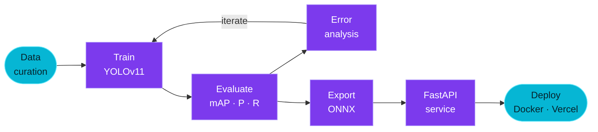

<!-- ═══════════════ HERO ═══════════════ -->
<p align="center">
  
</p>

<p align="center">
  <a href="https://git.io/typing-svg">
    
  </a>
</p>

<p align="center">
  <a href="https://maashg3l4-portfolio.vercel.app"></a>
  <a href="https://huggingface.co/warfazeee"></a>
  <a href="https://www.linkedin.com/in/md-masud-rana-2037592b7/"></a>
  <a href="mailto:mohammadsohag1256@gmail.com"></a>
</p>

<p align="center">
  
  
  
</p>

<!-- ═══════════════ ABOUT ═══════════════ -->
## 👋 About

```python
class MasudRana:
    role        = "AI/ML Engineer (early-career)"
    education   = "B.Sc. Computer Science, IUBAT"
    location    = "Sirajganj, Bangladesh (GMT+6)"
    focus       = ["Medical imaging", "Object detection (YOLOv11)", "Model deployment"]
    also_builds = ["REST APIs", "Dashboards", "Full-stack web apps"]
    open_to     = ["Research collaborations", "ML engineering roles", "Freelance"]
    reply_time  = "< 24 hours"
```

I build computer vision models for medical imaging and take them past the notebook: proper evaluation (held-out test sets, per-class metrics, error analysis) and deployment as working services.

<!-- ═══════════════ PIPELINE ═══════════════ -->
## 🧬 How I Work



<!-- ═══════════════ FOCUS ═══════════════ -->
## 🎯 Focus Areas

<table>
  <tr>
    <td width="33%" valign="top">
      <h3>🔬 Medical Imaging</h3>
      Detection models for scans, with metrics and failure analysis reported honestly.
    </td>
    <td width="33%" valign="top">
      <h3>⚙️ ML Engineering</h3>
      Reproducible training, ONNX export, containerized inference APIs, CI with GitHub Actions.
    </td>
    <td width="33%" valign="top">
      <h3>🌐 Full-Stack</h3>
      Django and FastAPI backends with Next.js and TypeScript front ends people actually use.
    </td>
  </tr>
</table>

<!-- ═══════════════ STACK ═══════════════ -->
## 🛠️ Tech Stack

<table>
  <tr>
    <td width="130" valign="top"><b>🧠 Machine Learning</b></td>
    <td>
      
      
      
      
      
      
    </td>
  </tr>
  <tr>
    <td valign="top"><b>🗄️ Backend</b></td>
    <td>
      
      
      
      
    </td>
  </tr>
  <tr>
    <td valign="top"><b>🎨 Frontend</b></td>
    <td>
      
      
      
      
    </td>
  </tr>
  <tr>
    <td valign="top"><b>🧰 Tools</b></td>
    <td>
      
      
      
      
    </td>
  </tr>
</table>

<!-- ═══════════════ CURRENT ═══════════════ -->
## 🔭 Currently Working On

| | Task | Status |
| :-: | :-- | :-- |
| 🟣 | Training and evaluating **YOLOv11** detectors on medical imaging data |  |
| 🟣 | Explainability for detection outputs (**Grad-CAM**) to support error analysis |  |
| 🟣 | Edge deployment: **ONNX export** and a **FastAPI** inference service |  |

<!-- ═══════════════ STATS ═══════════════ -->
## 📊 GitHub Stats

<p align="center">
  <picture>
    <source media="(prefers-color-scheme: dark)" srcset="https://github-readme-stats.vercel.app/api?username=maashg3l4&show_icons=true&hide_rank=true&hide=issues&hide_border=true&bg_color=00000000&title_color=A78BFA&text_color=C9D1D9&icon_color=22D3EE"/>
    <source media="(prefers-color-scheme: light)" srcset="https://github-readme-stats.vercel.app/api?username=maashg3l4&show_icons=true&hide_rank=true&hide=issues&hide_border=true&bg_color=00000000&title_color=7C3AED&text_color=24292F&icon_color=0891B2"/>
    
  </picture>
  <picture>
    <source media="(prefers-color-scheme: dark)" srcset="https://streak-stats.demolab.com?user=maashg3l4&hide_border=true&background=00000000&ring=A78BFA&fire=22D3EE&currStreakNum=C9D1D9&sideNums=C9D1D9&currStreakLabel=A78BFA&sideLabels=A78BFA&dates=8B949E"/>
    <source media="(prefers-color-scheme: light)" srcset="https://streak-stats.demolab.com?user=maashg3l4&hide_border=true&background=00000000&ring=7C3AED&fire=0891B2&currStreakNum=24292F&sideNums=24292F&currStreakLabel=7C3AED&sideLabels=7C3AED&dates=57606A"/>
    
  </picture>
</p>

<p align="center">
  
</p>

<!-- ═══════════════ SNAKE ═══════════════ -->
<p align="center">
  <picture>
    <source media="(prefers-color-scheme: dark)" srcset="https://raw.githubusercontent.com/maashg3l4/maashg3l4/output/snake-dark.svg"/>
    <source media="(prefers-color-scheme: light)" srcset="https://raw.githubusercontent.com/maashg3l4/maashg3l4/output/snake.svg"/>
    
  </picture>
</p>

<!-- ═══════════════ CONTACT ═══════════════ -->
## 📬 Let's Connect

<p align="center">
  Open to <b>research collaborations</b> · <b>ML engineering roles</b> · <b>freelance builds</b>
</p>

<p align="center">
  <a href="mailto:mohammadsohag1256@gmail.com"></a>
  <a href="https://www.linkedin.com/in/md-masud-rana-2037592b7/"></a>
  <a href="https://maashg3l4-portfolio.vercel.app"></a>
</p>


