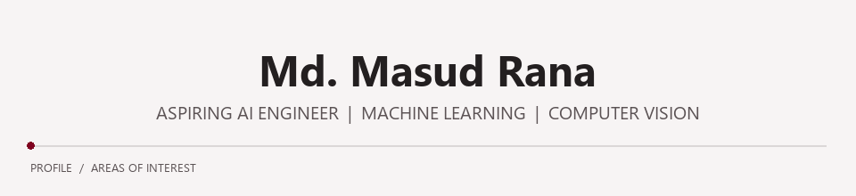

  <picture>
    <source media="(prefers-color-scheme: dark)" srcset="https://raw.githubusercontent.com/maashg3l4/maashg3l4/main/assets/profile-banner-dark.gif">
    <source media="(prefers-color-scheme: light)" srcset="https://raw.githubusercontent.com/maashg3l4/maashg3l4/main/assets/profile-banner-light.gif">
    
  </picture>

  

    
    
    
    
  

  B.Sc. in Computer Science, IUBAT · Bangladesh

---

## Areas of interest

| Area | Focus |
| :-- | :-- |
| **Computer vision** | Image understanding and object detection |
| **Medical imaging** | Applying machine learning to medical image analysis |
| **Reliable ML** | Evaluation, error analysis, and model interpretability |

## Contributions

  <picture>
    <source media="(prefers-color-scheme: dark)" srcset="https://raw.githubusercontent.com/maashg3l4/maashg3l4/output/snake-dark.svg">
    <source media="(prefers-color-scheme: light)" srcset="https://raw.githubusercontent.com/maashg3l4/maashg3l4/output/snake.svg">
    
  </picture>

