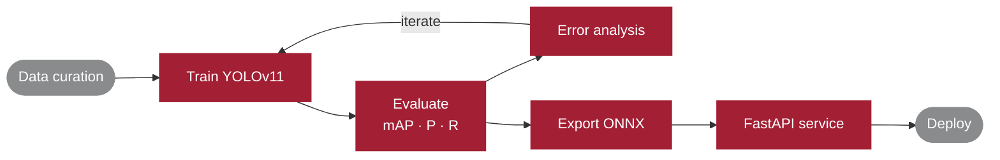

<h1 align="center">Md. Masud Rana</h1>

  <b>AI / ML Engineer</b> · Computer Vision · Medical Imaging 
  B.Sc. Computer Science, IUBAT · Sirajganj, Bangladesh (GMT+6)

  
  
  
  

---

## About

I build computer vision models for medical imaging and take them past the notebook: held-out test sets, per-class metrics, error analysis, and deployment as working services.

- **Research interests:** medical image analysis, object detection, model explainability
- **Also build:** REST APIs, dashboards, full-stack web apps
- **Open to:** research collaborations, ML engineering roles, freelance work

## Workflow

## Currently

| Focus | Status |
| :-- | :-- |
| Training and evaluating **YOLOv11** detectors on medical imaging data | In progress |
| Explainability for detection outputs (**Grad-CAM**) | Learning |
| **ONNX** export and **FastAPI** inference service | Learning |

## Tech Stack

**Machine Learning** &nbsp;

**Backend** &nbsp;

**Frontend** &nbsp;

**Tools** &nbsp;

## GitHub Activity

  <picture>
    <source media="(prefers-color-scheme: dark)" srcset="https://github-readme-stats.vercel.app/api?username=maashg3l4&show_icons=true&hide_rank=true&hide=issues&hide_border=true&bg_color=00000000&title_color=E5A0AB&text_color=C9D1D9&icon_color=A31F34"/>
    <source media="(prefers-color-scheme: light)" srcset="https://github-readme-stats.vercel.app/api?username=maashg3l4&show_icons=true&hide_rank=true&hide=issues&hide_border=true&bg_color=00000000&title_color=A31F34&text_color=24292F&icon_color=A31F34"/>
    
  </picture>

  <picture>
    <source media="(prefers-color-scheme: dark)" srcset="https://raw.githubusercontent.com/maashg3l4/maashg3l4/output/snake-dark.svg"/>
    <source media="(prefers-color-scheme: light)" srcset="https://raw.githubusercontent.com/maashg3l4/maashg3l4/output/snake.svg"/>
    
  </picture>

## Contact

Reply time is usually under 24 hours.
**[mohammadsohag1256@gmail.com](mailto:mohammadsohag1256@gmail.com)** · [LinkedIn](https://www.linkedin.com/in/md-masud-rana-2037592b7/) · [Portfolio](https://maashg3l4-portfolio.vercel.app)
